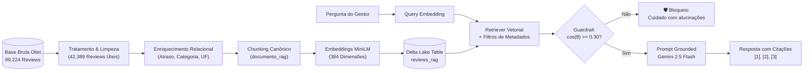

# 🎙️ Voice of Customer (VoC) Intelligence com RAG — E-commerce Olist

> **Tech Challenge - Fase 4 (IA Generativa & RAG)**  
> Solução de inteligência analítica baseada em **Retrieval-Augmented Generation (RAG)** com persistência no **Databricks Delta Lake**, busca vetorial por cosseno e **Guardrail Anti-Alucinação** para exploração estratégica de avaliações de clientes no e-commerce brasileiro.

---

## 🎯 Problema de Negócio & Objetivo

Empresas de e-commerce acumulam dezenas de milhares de avaliações de clientes que vão além de uma nota de 1 a 5 estrelas. Os verdadeiros motivos de insatisfação (atrasos logísticos, defeitos, embalagens violadas, divergência de anúncios) ou de fidelização encontram-se dispersos nos **comentários em texto livre**.

Esta solução transforma a base pública da **Olist** (~100 mil pedidos) em uma **base de conhecimento vetorial inteligente e auditável**, permitindo que analistas de CX e gestores realizem consultas em linguagem natural e recebam **sínteses analíticas estritamente fundamentadas em evidências reais**, com citações rastreáveis `[1]`, `[2]`, `[3]` e trava rigorosa contra alucinações.

---

## 🏗️ Arquitetura da Solução



Para detalhes aprofundados do fluxo e decisões arquiteturais, acesse **[`docs/arquitetura.md`](./docs/arquitetura.md)**.

---

## 🛠️ Tecnologias & Bibliotecas Utilizadas

| Camada | Tecnologia / Biblioteca | Finalidade |
| :--- | :--- | :--- |
| **Plataforma & Lakehouse** | **Databricks / Delta Lake / PySpark** | Armazenamento transacional ACID e consultas escaláveis em Spark SQL. |
| **Embeddings Semânticos** | `sentence-transformers` (`paraphrase-multilingual-MiniLM-L12-v2`) | Vetorização densa multilíngue (384-D) otimizada para português informal. |
| **Modelo Generativo (LLM)** | **Google Gemini 2.5 Flash** (`google-generativeai`) / MLflow | Síntese executiva com temperatura `0.1` e estrito grounding nas evidências. |
| **Recuperação & Métricas** | `numpy`, `scikit-learn`, `pandas` | Cálculo de similaridade de cosseno em vetores normalizados e filtros de metadados. |
| **Interface Interativa (UI)** | HTML5 + Tailwind CSS + JavaScript ES6 | Interface web interativa (*VoC Agent UI*) com 1.200 reviews reais embutidos e explorador Delta Lake. |

---

## 📁 Estrutura de Pastas do Repositório

```text
.
├── README.md                            # Documentação principal e guia de reprodução
├── requirements.txt                     # Dependências Python do pipeline
├── .env.example                         # Modelo de variáveis de ambiente (API Keys)
├── .gitignore                           # Regras de versionamento
│
├── data/                                # Dados e dicionário da base
│   ├── README.md                        # Especificação das 8 tabelas da Olist
│   └── sample_reviews_rag.csv           # Amostra real de 1.200 reviews exportados do Delta Lake
│
├── notebooks/                           # Notebook Databricks completo
│   ├── README.md                        # Instruções de importação no Databricks
│   └── Voice_of_Customer_RAG_Olist.ipynb# Pipeline completo (EDA, Delta Lake, RAG e Testes)
│
├── src/                                 # Código-fonte modularizado da solução
│   ├── main.py                          # CLI para execução local do pipeline RAG
│   ├── ingestion/                       # Limpeza de textos, nulos e enriquecimento relacional
│   │   └── preprocessing.py
│   ├── indexing/                        # Geração de embeddings 384-D e persistência
│   │   └── embedder.py
│   ├── retrieval/                       # Busca vetorial com metadados e guardrail
│   │   ├── retriever.py
│   │   └── guardrail.py                 # Trava de segurança "Cuidado com alucinações"
│   ├── generation/                      # Prompts strictly-grounded e integração Gemini
│   │   ├── prompt_templates.py
│   │   └── generator.py
│   └── app/                             # Interface Web Interativa VoC
│       ├── voc_agent_ui.html            # Frontend completo com busca em tempo real
│       └── run_app.py                   # Servidor local para abrir a UI no navegador
│
└── docs/                                # Documentação detalhada e evidências
    ├── README.md                        # Índice da documentação técnica
    ├── arquitetura.md                   # Diagramas e justificativas técnicas
    ├── tratamento_dados.md              # Diagnóstico de limpeza e enriquecimento
    └── casos_de_teste_rag.md            # Demonstração prática de perguntas e respostas
```

---

## 🧹 Estratégia de Preparação da Base & Metadados

O tratamento completo dos dados foi executado antes da etapa de vetorização (documentado em detalhes em **[`docs/tratamento_dados.md`](./docs/tratamento_dados.md)**):

1. **Diagnóstico & Seleção (Eliminação de Ruído):**
   - A base bruta (`olist_order_reviews_dataset.csv`) possuía **99.224 avaliações**.
   - **57,28% (56.835 avaliações)** continham apenas nota numérica de 1 a 5 estrelas sem comentário ou título. Foram descartadas para evitar ruído vetorial e alucinações.
   - Restaram **42.389 avaliações textuais únicas** (`drop_duplicates(subset=['review_id'])`).
2. **Enriquecimento Relacional (Desafio Adicional do Edital):**
   - Cruzamento com tabelas de Pedidos, Itens, Produtos, Categorias, Clientes e Pagamentos.
   - Cálculo exato do atraso logístico (`dias_atraso` e flag booleana `atrasou`).
   - Tradução e preenchimento de nulos das categorias (`não informada`).
3. **Chunking Canônico (`documento_rag`):**
   Cada avaliação foi higienizada (Regex) e estruturada em um formato contextual único combinando metadados e texto livre:
   ```text
   Nota: 1/5 | Categoria: telefonia | Entrega: No prazo | Cliente: SP | Comentário: A película não é de vidro, é acrílico, portanto não corresponde ao produto ofertado.
   ```

---

## 🛡️ Justificativa das Principais Decisões Técnicas

1. **Por que Embeddings Multilíngues (`paraphrase-multilingual-MiniLM-L12-v2`)?**  
   Os comentários da Olist possuem linguagem informal, gírias e erros de acentuação. O modelo multilíngue captura similaridades semânticas nativas em português com vetores compactos de 384 dimensões.
2. **Por que Guardrail Duplo (`Cuidado com alucinações`)?**  
   Atendendo ao **Requisito 4** do desafio, perguntas fora do escopo do e-commerce ou com baixa correspondência vetorial ($\cos(\theta) < 0.30$) são interceptadas antes mesmo de chegar ao modelo generativo, emitindo uma recusa auditável e garantindo **zero alucinação**.
3. **Por que Temperatura `0.1` e Citações Indexadas `[1]`, `[2]`?**  
   Reduz a criatividade especulativa do LLM e obriga cada afirmação da resposta analítica a apontar exatamente para a avaliação real que a originou.

---

## 🧪 Exemplos de Perguntas e Respostas (Casos de Teste)

| Cenário | Pergunta Testada | Resultado / Comportamento Esperado |
| :--- | :--- | :--- |
| **1. Notas Baixas** | *"Quais são os principais problemas relatados nas avaliações com nota baixa?"* | Filtra `score <= 2`, recupera queixas reais de extravio (`+22 dias`), divergência de material e pedidos incompletos com citações `[1]`, `[2]`, `[3]`. |
| **2. Defeito / Qualidade** | *"O que os clientes relatam sobre defeito, itens falsificados ou qualidade?"* | Identifica películas quebradas no transporte, ausência de retorno do pós-venda e itens com especificação inferior ao anúncio. |
| **3. Elogios** | *"Quais aspectos da experiência de compra são mais elogiados?"* | Filtra `score >= 4` e destaca entregas antecipadas (ex: `-20 dias`), confiabilidade e conformidade visual. |
| **4. Anti-Alucinação** | *"Qual a cor do cavalo Branco de Napoleão Bonaparte?"* / *"Receita de bolo de cenoura?"* | Aciona imediatamente o bloqueio **🛡️ Cuidado com alucinações** ($\cos(\theta) < 0.30$), recusando a resposta sem inventar dados. |

Veja a transcrição completa com as evidências recuperadas em **[`docs/casos_de_teste_rag.md`](./docs/casos_de_teste_rag.md)**.

---

## 🚀 Como Instalar, Configurar e Reproduzir a Solução

### Pré-requisitos
- Python 3.10 ou superior
- Chave de API gratuita do Google Gemini (via Google AI Studio) — *opcional caso deseje executar apenas a busca vetorial e a interface Web*

### 1. Clonar o repositório e instalar dependências
```bash
git clone https://github.com/winnytavares/fase-4-RAG-ecommerce.git
cd fase-4-RAG-ecommerce

python -m venv venv
# Windows
.\venv\Scripts\activate
# Linux / macOS
source venv/bin/activate

pip install -r requirements.txt
```

### 2. Configurar variáveis de ambiente
```bash
cp .env.example .env
# Edite o arquivo .env e insira sua GEMINI_API_KEY
```

### 3. Executar a Interface Web Interativa (*VoC Agent UI*)
Você pode explorar os **1.200 reviews reais** do Delta Lake visualmente, testar filtros, consultar a tabela de dados e validar o Guardrail anti-alucinação no navegador:
```bash
python src/app/run_app.py
```
*(Ou abra diretamente o arquivo `src/app/voc_agent_ui.html` em qualquer navegador).*

### 4. Executar o Pipeline Python via Terminal (CLI)
Executa o encoder `MiniLM`, realiza a busca vetorial em `data/sample_reviews_rag.csv`, aplica o guardrail e gera a síntese via Gemini:
```bash
# Exemplo de consulta no escopo:
python src/main.py -p "Quais os principais problemas com entregas atrasadas?" --nota_max 2 -k 4

# Exemplo testando o Guardrail Anti-Alucinação:
python src/main.py -p "Qual a cor do cavalo Branco de Napoleão Bonaparte?"
```

### 5. Executar o Pipeline Completo no Databricks (99 mil reviews)
Importe o arquivo `notebooks/Voice_of_Customer_RAG_Olist.ipynb` no Databricks, conecte ao dataset completo da Olist no Volume e execute todas as células para construir a tabela completa `workspace.default.reviews_rag`.
