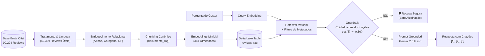

# Voice of Customer Intelligence com RAG (Olist E-Commerce)
## Tech Challenge - Fase 4 | Inteligência Artificial & Retrieval-Augmented Generation

[](https://www.python.org/)
[](https://databricks.com/)
[](https://delta.io/)
[](https://huggingface.co/)
[](https://ai.google.dev/)
[](https://www.databricks.com/)

> **Solução corporativa de Voice of Customer (VoC) para análise e exploração de mais de 42 mil avaliações de e-commerce utilizando Retrieval-Augmented Generation (RAG), embeddings multilíngues, enriquecimento relacional com metadados e prevenção estrita de alucinações.**

---

## 📌 1. Visão Geral e Problema de Negócio

No setor de comércio eletrônico, compreender a experiência do consumidor (**Voice of Customer - VoC**) é um pilar estratégico indispensável para retenção de clientes, redução de cancelamentos e aprimoramento de produtos.

Empresas recebem diariamente milhares de avaliações. Embora indicadores quantitativos (como notas de 1 a 5 estrelas) acompanhem a média de satisfação, a causa raiz dos gargalos operacionais e os motivos de fidelização encontram-se nos **dados não estruturados** (comentários em texto livre). Analisar manualmente dezenas de milhares de avaliações é impraticável, demorado e pouco escalável.

### O Desafio
Desenvolver uma solução inteligente baseada em **Retrieval-Augmented Generation (RAG)** sobre a base de dados pública da **Olist** (composta por aproximadamente 100 mil pedidos entre 2016 e 2018), capaz de:
- Transformar textos não estruturados em uma base de conhecimento semântica consultável;
- Responder a perguntas analíticas em linguagem natural com **fundamentação obrigatória em evidências reais**;
- Permitir **rastreabilidade total** das avaliações que sustentam cada insight;
- **Evitar alucinações**, identificando e rejeitando situações em que não há dados suficientes ou a pergunta foge do escopo do e-commerce.

---

## 🏗️ 2. Arquitetura da Solução

O fluxo da solução foi desenhado com foco em modularidade, velocidade de inferência e governança de dados:



Consulte a documentação completa da arquitetura em **[`docs/arquitetura.md`](./docs/arquitetura.md)**.

---

## ⚙️ 3. Tecnologias e Bibliotecas

| Camada | Tecnologia | Justificativa Técnica |
| :--- | :--- | :--- |
| **Plataforma de Dados** | Databricks Lakehouse & Unity Catalog | Governança unificada de dados, processamento distribuído e Volumes para armazenamento dos CSVs. |
| **Armazenamento Vetorial** | Delta Lake (`workspace.default.reviews_rag`) | Suporte transacional ACID, versionamento temporal (*time-travel*) e leitura otimizada em Spark SQL. |
| **Linguagem & Bibliotecas** | Python 3.10+, PySpark, Pandas, NumPy | Limpeza, enriquecimento relacional e operações matriciais de similaridade por cosseno. |
| **Análise Exploratória (EDA)** | Matplotlib & Seaborn | Visualização gráfica de distribuição de notas, volumetria e correlações de negócio. |
| **Modelo de Embeddings** | `paraphrase-multilingual-MiniLM-L12-v2` | Suporte robusto a mais de 50 idiomas incluindo português coloquial, 384 dimensões e alta velocidade. |
| **Modelo Generativo Principal** | Google Gemini (`google-genai`) | Alta janela de contexto, rapidez de resposta e excelente capacidade de seguir instruções de *grounding*. |
| **Modelo Generativo Alternativo** | Databricks Meta Llama 3.1 70B | Suporte corporativo local via Databricks Foundation Model API / MLflow Deployments. |
| **Interface Interativa (UI)** | HTML5 + Tailwind CSS + JS ES6 (`voc_agent_ui.html`) | Interface interativa standalone com **1.200 avaliações reais** exportadas do Delta Lake para simulação e testes imediatos. |

---

## 🔬 4. Decisões Técnicas e Metodológicas (Tratamento & RAG)

Para o detalhamento passo a passo do tratamento, consulte **[`docs/tratamento_dados.md`](./docs/tratamento_dados.md)**.

### 4.1. Seleção dos Dados e Tratamento de Nulos (Seção 2 do Notebook)
- **Diagnóstico:** A tabela `olist_order_reviews_dataset` continha **99.224 registros brutos**.
- **Identificação de Nulos:** **56.835 clientes (57,28%) não escreveram texto**, informando apenas a nota numérica (1 a 5 estrelas).
- **Decisão:** Manter exclusivamente as **42.389 avaliações com conteúdo textual real** (mensagem ou título preenchido) e desduplicar registros por `review_id`. Isso garante que a base vetorial seja alimentada apenas por linguagem natural relevante, evitando alucinações.

### 4.2. Desafio Adicional: Metadados e Exploração Contextual (Seção 3 do Notebook)
A solução enriqueceu a base com o cruzamento relacional de 8 tabelas do ecossistema Olist:
1. **Cálculo de Atraso Real na Entrega:** Diferença em dias entre `order_delivered_customer_date` e `order_estimated_delivery_date`. Criou-se a flag booleana `atrasou` e a contagem inteira `dias_atraso`.
2. **Prova de Conceito de Negócio:** Foi comprovado estatisticamente no notebook que **a entrega atrasada derruba a nota média de avaliação de 4.16 para 1.70**, justificando o uso do filtro de atraso nas análises de CX.
3. **Categorias e Localização:** Tradução das categorias para o português (imputando `"não informada"` nos nulos) e inclusão da UF do comprador e vendedor.
4. **Higienização e Formatação do Documento RAG (`documento_rag`):**
   ```text
   Nota: 1/5 | Categoria: utilidades_domesticas | Entrega: Atrasada 4 dias | Cliente: SP | Título: Atraso recorrente | Comentário: Não é a primeira vez de atraso na entrega, atendente pede prazo extra...
   ```

### 4.3. Prevenção de Alucinação: "🛡️ Cuidado com alucinações" (Requisito 4)
Para garantir fidelidade aos dados:
1. **Filtro de Escopo e Limiar Mínimo ($\cos(\theta) \ge 0.30$):** Perguntas fora do domínio (ex: *"Qual a cor do cavalo Branco de Napoleão Bonaparte?"*, *"Receita de bolo de cenoura"*) ou com baixa similaridade vetorial são bloqueadas antes da geração de texto.
2. **Grounding Rigoroso e Citações:** O prompt obriga o modelo a responder exclusivamente com base nas avaliações recuperadas, citando cada fonte com `[1]`, `[2]`, `[3]`.

---

## 📊 5. Demonstração Prática e Casos de Teste do Edital

Veja a transcrição completa dos resultados em **[`docs/casos_de_teste_rag.md`](./docs/casos_de_teste_rag.md)**:

| Cenário | Pergunta Realizada | Filtro de Metadados | Comportamento do RAG |
| :--- | :--- | :--- | :--- |
| **1. Principais Problemas** | *"Quais são os principais problemas relatados nas avaliações com nota baixa?"* | `nota_maxima=2`, `top_k=4` | Recupera avaliações críticas sobre extravio, atraso de +22 dias e divergência de anúncios, citando `[1]`, `[2]`, `[3]`. |
| **2. Defeito e Falsificação** | *"O que os clientes relatam sobre defeito, itens falsificados ou qualidade dos produtos?"* | Busca por termos de defeito/qualidade | Identifica relatos de itens quebrados no transporte (películas, fones), material inferior ao anunciado e descaso no pós-venda. |
| **3. Satisfação & Elogios** | *"Quais aspectos da experiência de compra são mais elogiados pelos clientes satisfeitos?"* | `nota_minima=4` | Destaca entregas antecipadas (até 20 dias antes do prazo) e conformidade visual como alavancas de fidelização. |
| **4. Anti-Alucinação (Req. 4)** | *"Qual a cor do cavalo Branco de Napoleão Bonaparte?"* / *"Receita de bolo de cenoura?"* | `min_similarity=0.30` | **Bloqueio preventivo ativado (`Cuidado com alucinações`).** O sistema detecta $\cos(\theta) < 0.30$ e recusa a resposta sem inventar informações. |

---

## 🚀 6. Instruções de Instalação e Execução

### Opção A: Interface Web Interativa (Pronta para Teste Instantâneo)
Incluímos uma aplicação web interativa (*VoC Agent UI*) pré-carregada com **1.200 avaliações reais** exportadas do Delta Lake (`workspace.default.reviews_rag`):
```bash
python src/app/run_app.py
```
*(Acesse `http://localhost:8501/voc_agent_ui.html` ou abra diretamente o arquivo [`src/app/voc_agent_ui.html`](./src/app/voc_agent_ui.html) no seu navegador).*

### Opção B: Execução Local via Pipeline Python (CLI)
1. Clone o repositório e instale as dependências:
   ```bash
   git clone https://github.com/winnytavares/fase-4-RAG-ecommerce.git
   cd fase-4-RAG-ecommerce
   python -m venv venv
   .\venv\Scripts\activate      # Windows (ou source venv/bin/activate no Linux/Mac)
   pip install -r requirements.txt
   ```
2. Configure o `.env` a partir do `.env.example` e informe sua `GEMINI_API_KEY`.
3. Execute consultas pelo terminal sobre a amostra em `data/sample_reviews_rag.csv`:
   ```bash
   python src/app/main.py -p "Quais os principais problemas com entregas atrasadas?" --nota_max 2 -k 4
   ```

### Opção C: Execução Completa no Databricks (99 mil reviews)
1. Acesse seu workspace Databricks e importe o arquivo [`notebooks/voice_of_customer.ipynb`](./notebooks/voice_of_customer.ipynb).
2. Certifique-se de que os CSVs da Olist estejam em `/Volumes/workspace/default/fase4-ecommerce`.
3. Configure `GEMINI_API_KEY` via Secrets ou variável de ambiente e execute todas as células (`Run All`).

---

## 📁 7. Estrutura do Repositório

```text
├── data/
│   ├── .gitkeep
│   ├── README.md                        # Dicionário de dados e instruções do dataset Olist
│   └── sample_reviews_rag.csv           # Amostra real de 1.200 avaliações exportadas do Delta Lake
├── docs/
│   ├── .gitkeep
│   ├── README.md                        # Índice da documentação técnica
│   ├── arquitetura.md                   # Arquitetura, fluxo Mermaid e justificativas técnicas
│   ├── tratamento_dados.md              # Diagnóstico detalhado da limpeza e enriquecimento
│   └── casos_de_teste_rag.md            # Exemplos reais de perguntas, evidências e recusas
├── notebooks/
│   ├── .gitkeep
│   ├── README.md                        # Guia de execução do notebook no Databricks
│   └── voice_of_customer.ipynb          # Notebook completo (EDA, Delta Lake, Embeddings e RAG)
├── src/
│   ├── __init__.py
│   ├── app/
│   │   ├── __init__.py
│   │   ├── main.py                      # Orquestrador CLI do pipeline RAG
│   │   ├── run_app.py                   # Servidor local para a interface Web VoC
│   │   └── voc_agent_ui.html            # Interface Web Interativa com 1.200 reviews reais
│   ├── generation/
│   │   ├── __init__.py
│   │   └── llm.py                       # Prompt engineering e integração Google Gemini
│   ├── indexing/
│   │   ├── __init__.py
│   │   └── embeddings.py                # Vetorização multilíngue MiniLM-L12-v2 (384-D)
│   ├── ingestion/
│   │   ├── __init__.py
│   │   └── load_data.py                 # Limpeza, desduplicação, atrasos e chunks RAG
│   └── retrieval/
│       ├── __init__.py
│       ├── guardrail.py                 # Trava de segurança anti-alucinação ("Cuidado com alucinações")
│       └── search.py                    # Busca semântica por cosseno com filtros de metadados
├── .env.example                         # Modelo de variáveis de ambiente
├── .gitignore                           # Proteção contra versionamento de chaves e temporários
├── README.md                            # Documentação principal da solução
└── requirements.txt                     # Lista de dependências Python
```

---

## 🎥 8. Vídeo de Apresentação

O vídeo está disponível em:

---

## 👥 9. Equipe do Projeto:
- **Ana Beatriz Porto** — RM 372544
- **Jade Ferreira** — RM 373208
- **Felipe Nadal** — RM 372547
- **Winny Tavares** — RM 371471
- **Curso:** Pós-Tech AI / Tech Challenge - Fase 4
