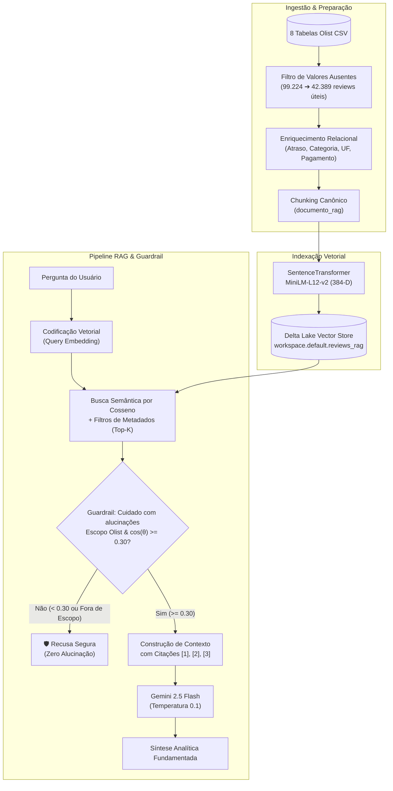

# 🏗️ Arquitetura da Solução RAG (Voice of Customer Intelligence)

Este documento detalha a arquitetura ponta a ponta da solução **Voice of Customer (VoC) Intelligence**, desde a ingestão relacional no Databricks Delta Lake até o mecanismo de geração fundamentada com barreira de segurança anti-alucinação.

---

## 🔄 Fluxo Ponta a Ponta do Pipeline

---

## 🛠️ Justificativas das Decisões Técnicas

### 1. Modelo de Embeddings (`paraphrase-multilingual-MiniLM-L12-v2`)
- **Por que multilíngue?** Os comentários dos clientes brasileiros estão em português informal, muitas vezes com abreviações (ex: `"mto bom"`, `"pq"`, `"vc"`) e erros de digitação. O modelo multilíngue captura similaridades semânticas nativas em português sem depender de tradução prévia.
- **Dimensão de 384-D:** Garante excelente balanço entre riqueza semântica e baixa latência em buscas por similaridade de cosseno.
- **Vetores Normalizados ($L_2$):** Permite calcular a similaridade por produto escalar direto (`dot product`), reduzindo drasticamente o custo computacional.

### 2. Armazenamento e Persistência no Delta Lake (`workspace.default.reviews_rag`)
- **Por que Delta Lake?** Oferece transações ACID, versionamento (*Time Travel*) e integração nativa com o ecossistema Spark SQL no Databricks para filtrar rapidamente metadados antes ou durante a recuperação vetorial.

### 3. Mecanismo de Guardrail ("Cuidado com alucinações")
- **Dupla Camada de Proteção:**
  1. **Filtro Semântico de Escopo:** Identifica desvios de domínio externos ao e-commerce (ex: culinária, história, esportes, política).
  2. **Limiar de Similaridade Mínimo ($\cos(\theta) \ge 0.30$):** Mesmo quando há palavras parecidas, se a distância vetorial indicar baixa correspondência contextual ($< 0.30$), o sistema aborta a chamada generativa e emite uma mensagem auditável de recusa.

### 4. Modelo Generativo (`Gemini 2.5 Flash` com Temperatura `0.1`)
- Configurado com temperatura próxima de zero e *system prompt* estrito de ancoragem (*Strictly Grounded*), obrigando o modelo a referenciar os índices `[1]`, `[2]`, `[3]` das avaliações reais recuperadas.
